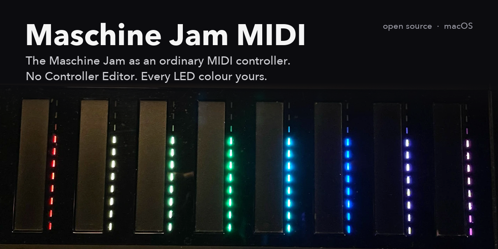

# Maschine Jam MIDI



**Use the Native Instruments Maschine Jam as an ordinary MIDI controller, without Controller Editor and with full control of every LED colour.**

Normally the Maschine Jam only works as a MIDI controller while NI's Controller Editor runs. Even then it has hardware pages, Shift and Select send nothing, and you can't freely set the colours. `jam-midi` is a small open-source driver that talks to the Jam over USB itself. It turns the Jam into a plain MIDI device called **Maschine Jam MIDI** that any app can use: Resolume, Ableton Live, Bitwig, TouchDesigner, a DAW, or your own code.

- **Every control sends MIDI:** 64 pads, scene and group keys, every other key including Shift and Select, the encoder (absolute and relative, plus push and touch), and all 8 touch strips (position and touch).
- **Every LED listens to MIDI:** pad, scene and group colours (68 colours), key brightness, the touch strip LEDs (as a bar or one by one), and the level meter.
- **No hardware pages:** every control sends one fixed message, and every LED has one fixed address.
- **Compatible:** the numbers follow page 1 / page A of NI's default template, so a mapping made for that template mostly still works. The few exceptions are listed in [MIDI-MAP.md](MIDI-MAP.md).
- **Easy to install:** a menu bar app that starts at login, or a command line tool. No dependencies, and it picks the Jam up again after a replug.

**Platform:** macOS, and Windows 10/11 as a command line tool — see
[windows/README.md](windows/README.md). On Windows you have to stop NI's `NIHardwareService` and
install [loopMIDI](https://www.tobias-erichsen.de/software/loopmidi.html) for the MIDI port, both
explained there. [WINDOWS.md](WINDOWS.md) is the original handover.

| File | What |
|---|---|
| [MIDI-MAP.md](MIDI-MAP.md) | every MIDI message in and out, and the colour palette |
| [PROTOCOL.md](PROTOCOL.md) | the Jam's USB HID protocol, as checked on a real Jam |
| [WINDOWS.md](WINDOWS.md) | handover for building the Windows version |
| [windows/README.md](windows/README.md) | the Windows build: how to build it, run it, and what differs |
| `windows/` | the Windows driver: a C++17 port of the driver, HID through Win32, MIDI through WinMM |
| `Sources/Driver/` | the driver, shared by the app and the command line tool |
| `Sources/App/` | the menu bar app |
| `Sources/CLI/` | the command line tool `jam-midi` |
| `Tools/` | test tools: send MIDI, test the strip colours |
| `scripts/` | build, install, make the DMG, draw the icon |

## Install the app

The easy way is **Maschine Jam MIDI.app**, a small menu bar app (macOS 13 or newer, Apple Silicon and Intel).

1. Download the `.dmg` from [Releases](https://github.com/tijnisfijn/maschine-jam-midi/releases/latest), open it, and drag **Maschine Jam MIDI** to Applications.
2. The app is not notarised, so macOS blocks it the first time. Unblock it once:
   ```bash
   xattr -dr com.apple.quarantine "/Applications/Maschine Jam MIDI.app"
   ```
   Or open it, then go to System Settings → Privacy & Security and click **Open Anyway**.
3. Open it. A grid icon appears in the menu bar. It's filled in while the Jam is connected.
4. In your app (Resolume, Ableton, ...), choose **Maschine Jam MIDI** as the MIDI input and output.

The menu shows whether the Jam is connected and the MIDI port. It also has:
- **Colour Test:** shows a rainbow on every LED. Choose it again to switch back.
- **Start at Login:** on after the first start, so the Jam just works after a restart. Click it to switch it off.
- **MIDI Map:** opens the map.
- **Quit:** turns the LEDs off and quits.

Run the app *or* the command line tool, not both: each makes its own **Maschine Jam MIDI** port.

## Install on Windows

Windows 10/11, as a command line tool. Download `maschine-jam-midi-<version>-windows-setup.exe`
from [Releases](https://github.com/tijnisfijn/maschine-jam-midi/releases/latest), or build it
yourself with `windows\installer\build-installer.ps1`.

**It is not signed.** There is no code-signing certificate behind this project, so SmartScreen
shows *"Windows protected your PC"* the first time. Click **More info**, then **Run anyway** — or
build it from source, which takes nothing but Visual Studio Build Tools. The installer is
per-user, so it asks for no administrator rights.

Two things Windows needs that macOS does not:

1. **Stop NI's service**, or it fights the driver over the LEDs (as administrator):
   ```powershell
   Stop-Service -Name NIHardwareService -Force
   Set-Service  -Name NIHardwareService -StartupType Manual
   ```
2. **Install [loopMIDI](https://www.tobias-erichsen.de/software/loopmidi.html)**, because Windows
   cannot make a MIDI port by itself. Make two ports in it called `Maschine Jam MIDI` and
   `Maschine Jam MIDI Feedback` and the driver uses those, with no licence attached to anything.
   Without them it falls back to making its own single port through loopMIDI's teVirtualMIDI SDK,
   which is free for personal use but needs a licence for commercial use.

[windows/README.md](windows/README.md) has the whole story, including what happens when Windows
MIDI Services makes all of this unnecessary.

## Build it yourself (macOS)

You need only Apple's command line tools (`xcode-select --install`). There are no other dependencies.

```bash
scripts/install.sh
```

This builds the app and installs it in /Applications. `scripts/build.sh` only builds, into `build/`. `scripts/make-dmg.sh` also makes the DMG.

## The command line tool

`scripts/build.sh` also builds `build/jam-midi`, the same driver without the app. It's useful for testing and scripts, and runs on macOS 11 or newer. A ready-built zip is under Releases too.

```bash
./build/jam-midi
```

| Option | What |
|---|---|
| `-v` | print every control and every MIDI message |
| `--demo` | the colour test |
| `--raw` | print the raw HID reports |
| `--name NAME` | name of the MIDI ports |

It waits for the Jam and picks it up again after a replug. Ctrl-C turns the LEDs off and quits.

Two tools help with testing:
- `build/jam-send "Maschine Jam MIDI" B0 4C 7F` sends raw MIDI to the driver.
- `build/strip-test 1|2|3` writes test colours straight to the strip LEDs. Stop the driver before you run it.

## NI's software

Controller Editor does not need to run. NI's `NIHardwareAgent` can keep running: macOS lets both open the Jam, and the agent does not overwrite the LEDs. The driver writes the LEDs again every 2 seconds anyway. NI's own `Maschine Jam - 1` ports stay as well. Use **Maschine Jam MIDI** instead.

## Made with AI

This driver was built by Tijn together with Claude (Anthropic's AI) in Claude Code. Claude wrote the code and the docs. Every control, LED and colour was checked by hand on a real Maschine Jam. Issues and pull requests are welcome.

## Credits and licence

MIT licence, see [LICENSE](LICENSE) and [NOTICE](NOTICE). The HID layout (which bit is which key, the LED reports and the colour palette) comes from [cabl](https://github.com/shaduzlabs/cabl), Copyright (C) 2015 Vincenzo Pacella, MIT licence. It was checked against a real Jam on 17 November 2026.

This is an independent project. It is not made by, endorsed by or connected to Native Instruments. Maschine and Maschine Jam are trademarks of Native Instruments GmbH.
